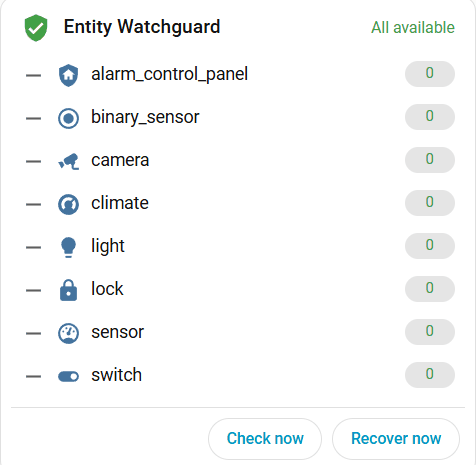
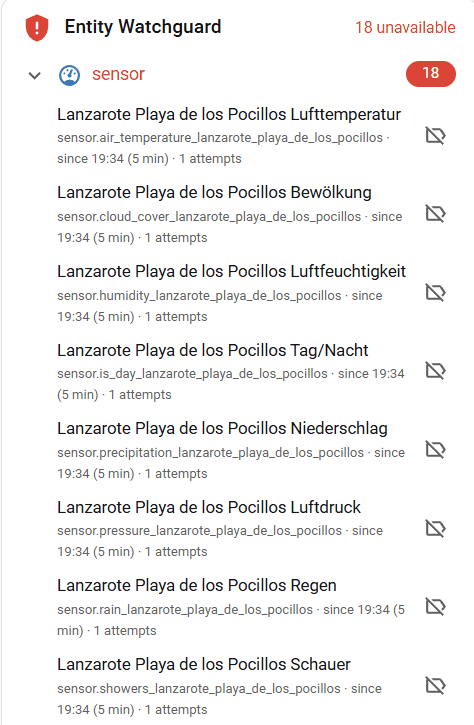

# Entity Watchguard

[](https://www.hacs.xyz/docs/marketplace/)
[](https://github.com/LuckyTriple7/ha-entity-watchguard/releases)

[](https://buymeacoffee.com/luckytriple7)

**English** · [Deutsch](README.de.md)

Home Assistant custom integration that watches your entities for the `unavailable` state, reports them per domain or per device, and tries to bring them back — the UI-configurable replacement for a pile of hand-written `unavailable` template sensors.

## Features

- One `problem` binary sensor per watched domain (`light`, `switch`, `sensor`, `binary_sensor`, …), listing the affected entities in its attributes, plus one overall problem sensor
- Counters for **unavailable entities** and **unavailable devices** — a dead device with a dozen entities counts once on the device sensor, which lists the device names and which of them are completely down
- Optional **count sensor per domain** (disabled by default) that shows the number of unavailable entities directly as its state
- Pick the watched domains in the UI as a checkbox list — it offers every domain that exists in your instance, and *Select all existing domains* ticks them all in one go
- Exceptions by **label**, **entity**, **device**, **area**, **integration**, **entity category** (e.g. diagnostic) and **regex pattern** on the entity ID
- Escalating recovery: stage 1 re-polls the entity (`homeassistant.update_entity`), stage 2 reloads the config entry the entity belongs to. Stage 2 repeats on a slow interval and gives up after a configurable number of attempts
- Stage 1 is skipped automatically for push integrations (MQTT, ZHA, ESPHome …), where re-polling cannot achieve anything
- **Events** for every recovery operation, its outcome and every entity that came back afterwards — for recovery statistics with automations and the recorder ([Events](#events))
- Startup grace period: after a Home Assistant restart the integration stays quiet for a configurable time, because entities need a few minutes to come up
- Three reporting channels, each switchable: **persistent notifications** (self-updating, auto-dismissed), **repair issues** (ignorable per domain), and an optional **notify service** for mobile push
- Report **per domain** or **per device**: per device, a dead device is one line across all its domains, only devices that are completely down are reported, and a power cut sends one push instead of one per device ([Notifications](#notifications))
- **Check now** / **Recover now** buttons for everything you don't want to wait for
- Built-in **dashboard card** with per-domain rows, per-entity outage details and a one-click "ignore this entity" action — registered automatically, nothing to install separately
- Light on CPU: one in-memory scan per interval (default 60 s), no template rendering and no state-change listeners. Long entity lists are kept out of the recorder

## How it works

Every check interval the integration walks the states of the watched domains, keeping the ones that are `unavailable` and not excluded. Each such entity gets an "outage" record with the time it started. From there:

```
unavailable detected
   ├─ grace period ......... short flapping is ignored
   ├─ stage 1 .............. homeassistant.update_entity (skipped for push integrations)
   ├─ stage 2 .............. reload the entity's config entry — only if enough
   │                         of that entry is down, repeated on the retry interval
   ├─ notify delay ......... notification / repair issue / notify service
   └─ give up .............. stop trying, keep reporting
```

The record is dropped the moment the entity is available again, so every timer starts fresh on the next outage.

## Dashboard card

The integration ships its own dashboard card, `custom:entity-watchguard-card` — one row per watched domain, expandable into the entities that are actually missing, with the recovery actions right there. Nothing to install separately.

| Nothing wrong | An outage, expanded |
|---|---|
|  |  |

Add a card, search for **Entity Watchguard**, or write it in YAML:

```yaml
type: custom:entity-watchguard-card
title: Entity Watchguard      # optional
show_ok_domains: true         # also list domains with nothing wrong
show_buttons: true            # Check now / Recover now
allow_ignore: true            # per-entity "ignore" action
ignore_label: offline         # label applied by that action
language: auto                # auto | de | en
```

- One row per watched domain with a counter; click to expand the affected entities
- Each entity shows since when it has been gone, how many recovery attempts ran, and whether Watchguard gave up
- The label button applies your ignore label to that entity — it is excluded from the next scan on, provided that label is listed under Configure → Exceptions. The label is created on first use
- German and English, follows the user's Home Assistant language; has a visual editor
- Finds its entities through the entity registry (platform, `domain` attribute, translation keys), so renaming entities or the device does not break it

### How the card gets loaded

The integration serves the card from `/entity_watchguard_static/entity-watchguard-card.js` and keeps **one** Lovelace resource (Settings → Dashboards → ⋮ → Resources) pointing at it:

- created on start if it is missing, its `?v=` updated after an update so browsers fetch the new card
- only that one entry is ever touched — the rest of your resources are left alone
- **removed again when you delete the integration**
- with resources managed in YAML nothing is written; the log names the URL to add yourself as a `module` resource

After an update, reload the browser once (Ctrl+F5 / Cmd+Shift+R).

### Coming from the standalone card (1.0.x)

For 1.0.x the card was a separate HACS dashboard repository, *Entity Watchguard Card*. It is retired — remove it under **Settings → Marketplace** (Home Assistant 2026.11 and newer) or in HACS → Dashboard → Entity Watchguard Card → ⋮ → **Remove** (2026.10 and older). Until you do, both copies are loaded; that is harmless, only the first one defines the card, and the log reminds you. Your card configuration needs no changes.

## Installation via the Marketplace

**Home Assistant 2026.11 and newer** — HACS is built in as the **Marketplace**:

1. Open **Settings → Marketplace**
2. Select **Add from link** (top right)
3. Enter `LuckyTriple7/ha-entity-watchguard` under **GitHub link** → **Add**
4. On the repository page select **Install** and confirm
5. Restart Home Assistant if the Marketplace asks for it

**Home Assistant 2026.10 and older** — via HACS:

1. Open HACS → **Integrations** → Menu (⋮) → **Custom repositories**
2. Enter URL: `https://github.com/LuckyTriple7/ha-entity-watchguard`
3. Category: **Integration** → **Add**
4. Search for **Entity Watchguard** → **Download**
5. Restart Home Assistant

## Configuration

**Settings → Devices & Services → Add Integration → Entity Watchguard**, then tick the domains to watch. *Select all existing domains* ticks every domain that has entities in your instance and opens the form again, so you can untick single ones before saving; helpers, automations, scripts, scenes, zones, `update`, `event` and similar domains are left out (you can still tick them by hand). Everything else uses defaults and can be changed later under **Configure**:

| Step | Setting | Default | Notes |
|---|---|---|---|
| Timings | Startup delay | 300 s | Counted from the moment HA has finished starting |
| Timings | Check interval | 60 s | How often the states are scanned |
| Timings | Grace period | 120 s | An entity must stay unavailable this long before it is reported |
| Recovery | Stage 1 (update entity) | on, after 300 s | `homeassistant.update_entity` — gentle. Automatically skipped for push integrations (`iot_class: *_push`), where it would be a no-op |
| Recovery | Stage 2 (reload config entry) | off, after 900 s | More effective, but all entities of that integration disappear briefly |
| Recovery | Reload only above | 50 % | Share of the config entry's entities that must be unavailable. Hub integrations (MQTT, ZHA, Z-Wave) have **one** config entry for hundreds of entities — without this, a single dead sensor would restart the whole broker. `0` disables the check |
| Recovery | Reload cooldown | 3600 s | Minimum distance between two reloads of the same config entry |
| Recovery | Max reloads per check | 3 | Guards against a reload storm |
| Recovery | Repeat stage 2 every | 3600 s | `0` = try stage 2 only once per outage |
| Recovery | Give up after | 3 attempts | `0` = never give up. A device that is simply switched off is not worth reloading forever; it stays reported, just without further attempts |
| Exceptions | Labels | – | Set on an entity, device or area; e.g. an `offline` label for devices you knowingly powered down |
| Exceptions | Entities / Devices / Areas | – | Explicit pickers |
| Exceptions | Integrations | – | Everything provided by that integration, e.g. `shelly`, `mqtt`, `hue` — useful for a whole system you knowingly leave offline |
| Exceptions | Entity categories | – | **Configuration** and/or **Diagnostic**. Diagnostic entities (signal strength, firmware update, last seen, uptime) often drop out while the device itself works fine. Careful: some integrations also put a connection status there, e.g. ESPHome's *Status* sensor — excluding Diagnostic hides that too. Excluded entities also don't count when deciding whether a device is *completely* unavailable |
| Exceptions | Patterns | – | Regex against the entity ID, e.g. `.*_internet_access$` |
| Notifications | Persistent notifications | on | Self-updating, auto-dismissed. Per domain: one notification per domain, entities of the same device collapsed into one line. Per device: one notification for all domains (see *Report per*) |
| Notifications | Repair issues | on | Mirrors the same outages into Settings → Repairs, where they can be ignored per domain |
| Notifications | Notify after | 900 s | Meant to fire *after* the recovery attempts have failed |
| Notifications | Report per | Domain | What the persistent notification and the notify service report. **Domain**: every unavailable entity, one notification per domain. **Device**: only devices whose watched entities are *all* unavailable — a dead Shelly with entities in three domains is one line instead of three notifications; a device with only a hung firmware-update entity is not reported. Entities that belong to no device (templates, helpers) are listed separately. **Both**: domain and device notifications side by side. Repair issues always stay per domain |
| Notifications | Notify service | – | Optional, e.g. `notify.mobile_app_phone`. Called only when something goes down or comes back, never on every check. Per device, everything that changed in one check goes into one message, so a power cut that takes out five devices sends one push |

Only one instance is supported — it watches the whole Home Assistant instance.

## Notifications

*Report per* (Configure → Notifications) decides what the persistent notification and the notify service report. Example: a dead Shelly with entities in `light` and `switch`, a hall lamp that is off at the wall, a plug whose relay is gone while its LED still works, and a template light without a device.

**Per domain** (default): one notification per domain, every unavailable entity, entities of the same device collapsed into one line.

```
Entity Watchguard – light (4)
Unavailable entities in `light`:
• Hall Lamp (light.hall) – since 20.11.2026 08:10
• Shelly Kitchen: 2 entities (light.relay1, light.relay2) – since 20.11.2026 08:15
• Template Light (light.template) – since 20.11.2026 08:12

Entity Watchguard – switch (2)
Unavailable entities in `switch`:
• Attic Plug (switch.attic) – since 20.11.2026 08:20
• Shelly Kitchen Relay 3 (switch.relay3) – since 20.11.2026 08:15
```

**Per device**: one notification for all domains, one line per device. Only devices whose watched entities are *all* unavailable are reported, so the attic plug (LED still on) is left out. Entities without a device get their own section.

```
Entity Watchguard – devices (2 devices, 1 without device)
Unavailable devices:
• Hall Lamp: 1 entity (light.hall) – since 20.11.2026 08:10
• Shelly Kitchen: 3 entities (light.relay1, light.relay2, switch.relay3) – since 20.11.2026 08:15

Unavailable, without a device:
• Template Light (light.template) – since 20.11.2026 08:12
```

**Both**: both kinds side by side.

The **notify service** follows the same setting and is only called on changes. Per domain it sends one message when a domain gets a problem and `light: all entities available again` when it is clean. Per device it sends one message per check with everything that went down (same text as above), and one for everything that came back:

```
Available again: Shelly Kitchen, Template Light
```

**Repair issues** always stay per domain, because there they can be ignored per domain.

Which one to pick: *per domain* if you want to know about every single entity, *per device* if you mainly care about dead hardware and want fewer, calmer messages. Partly unavailable devices always show up on the domain sensors, the device sensor and the dashboard card, whatever you pick here.

## Entities

| Entity | Type | Description |
|---|---|---|
| `binary_sensor.entity_watchguard_<domain>` | problem | ON when the domain has unavailable entities. Attributes: `count`, `unavailable_entities`, `unavailable_names`, `unavailable_since`, `recovery_attempts`, `given_up_entities`, `details` (per-entity rows: `entity_id`, `name`, `since`, `attempts`, `given_up`), `status`, `truncated` |
| `sensor.entity_watchguard_<domain>_unavailable` | count | Number of unavailable entities in that domain, as the state — for tiles, history graphs and long-term statistics (unit `entities`, state class `measurement`). **Disabled by default**, enable it per domain under Settings → Devices & services → Entity Watchguard → Entities. Attributes: `domain`, `warming_up` |
| `binary_sensor.entity_watchguard_problem` | problem | ON when any watched domain has a problem. Attributes: `affected_domains`, `unavailable_entities` |
| `sensor.entity_watchguard_unavailable_entities` | count | Total across all watched domains, `per_domain` breakdown in the attributes |
| `sensor.entity_watchguard_unavailable_devices` | count | Devices with at least one unavailable entity — a dead device with twelve entities counts once. Attributes: `unavailable_devices` (device names, one per device), `fully_unavailable` (number of devices with every watched entity down), `fully_unavailable_devices` (their names), `entities_without_device` (unavailable entities that belong to no device, e.g. templates), `details` (per-device rows: `device_id`, `name`, `count`, `entity_ids`, `since`, `given_up`, `fully_unavailable`), `truncated`, `warming_up` |
| `sensor.entity_watchguard_last_recovery_attempt` | timestamp | Diagnostic |
| `button.entity_watchguard_check_now` | button | Scan immediately instead of waiting for the check interval — also ends the startup grace period early |
| `button.entity_watchguard_recover_now` | button | Run stage 1 for everything currently unavailable, ignoring the delays |

During the startup grace period every problem sensor stays `off` and reports `status: warming_up`; the count sensors stay at `0`.

The entity and device lists are capped at 50 entries (`truncated: true` tells you there were more; `count` and the sensor states always stay exact) and are excluded from the recorder, so a large outage doesn't write the same long list into the database on every scan.

## Services

- `entity_watchguard.recover_now` — recover right now, ignoring the configured delays. Optional `domain`, `entity_id`, and `escalate: true` to also run stage 2.
- `entity_watchguard.clear_notifications` — dismiss all notifications created by this integration.

## Events

Every recovery operation is announced on the Home Assistant event bus, so recovery history can be recorded, counted and charted with standard tools (automations, counters, `history_stats`, the recorder) — independent of the outage records, which Watchguard drops as soon as an entity is back, and across reloads and restarts. Nothing to configure.

| Event | When | Data |
|---|---|---|
| `entity_watchguard_recovery_attempt` | A recovery operation actually ran: one stage 1 `update_entity` call (covering all its entities), or one stage 2 config entry reload. Skipped operations (push integration, cooldown, hub threshold, entry not loaded) fire nothing | `operation_id`, `stage` (1/2), `trigger` (`automatic`/`manual`), `timestamp`, `entity_ids`, `config_entry_id`, `config_entry_title`, `integration_domain` (stage 2 only, otherwise `null`), `integration_domains` (integrations of the affected entities), `watchguard_entry_id` |
| `entity_watchguard_recovery_result` | A stage 2 reload finished. Stage 1 has no result: `update_entity` is fire-and-forget | `operation_id`, `stage`, `trigger`, `timestamp`, `config_entry_id`, `config_entry_title`, `integration_domain`, `result` (`success`/`failed`), `error`, `watchguard_entry_id` |
| `entity_watchguard_entity_recovered` | An entity Watchguard ran at least one operation for is available again (not fired for entities that came back on their own, or were removed or excluded) | `entity_id`, `name`, `unavailable_since`, `timestamp`, `duration_seconds`, `attempts`, `stages` (stages that actually ran), `operation_ids`, `last_operation_id`, `watchguard_entry_id` |

`operation_id` ties an attempt to its result and to the entities that came back after it. `trigger` is `manual` for the *Recover now* button and the `recover_now` service.

Example — count stage 2 reloads in a counter helper:

```yaml
automation:
  - alias: Count Watchguard stage 2 reloads
    triggers:
      - trigger: event
        event_type: entity_watchguard_recovery_attempt
        event_data:
          stage: 2
    actions:
      - action: counter.increment
        target:
          entity_id: counter.watchguard_stage2
```

## Logging

Everything is written to the regular Home Assistant log under `custom_components.entity_watchguard`:

| Level | What |
|---|---|
| INFO | Entities going unavailable and coming back (including how long they were gone and which recovery stages ran), stage 1 and stage 2 attempts |
| WARNING | An exclusion pattern that isn't a valid regex (it is skipped) |
| ERROR | A stage 2 config entry reload that failed, with traceback |
| DEBUG | When the startup grace period ends, skipped reloads, reload completions |

```yaml
logger:
  logs:
    custom_components.entity_watchguard: debug
```

## Development

```bash
pip install -r requirements_test.txt
pytest                   # integration tests
node tests/card/smoke.js # card
```

Both run in CI on every push, alongside hassfest and the HACS validation.

## Notes

- Entities that are not in the entity registry (YAML/template entities) can only be exempted via **patterns** or the **entity** picker; label/device/area/integration/category exemptions need a registry entry.
- Stage 2 never reloads Entity Watchguard's own config entry, skips entries that are not loaded, and honours the cooldown.
- Push detection reads `iot_class` from the integration's manifest. Anything that can't be resolved is treated as pollable — one harmless service call is cheaper than a missed recovery.
- **Nothing showing up?** Check the `status` attribute of a domain sensor: `warming_up` means the startup delay is still running (press **Check now** to end it), `ok` with `count: 0` means nothing matched — verify the domain is actually watched and that the entities are `unavailable`, not `unknown`.
- Replacing template sensors: `label_entities('offline')` maps to the label exceptions, `rejectattr('entity_id', 'match', '.*_internet_access$')` maps to the pattern exceptions.
